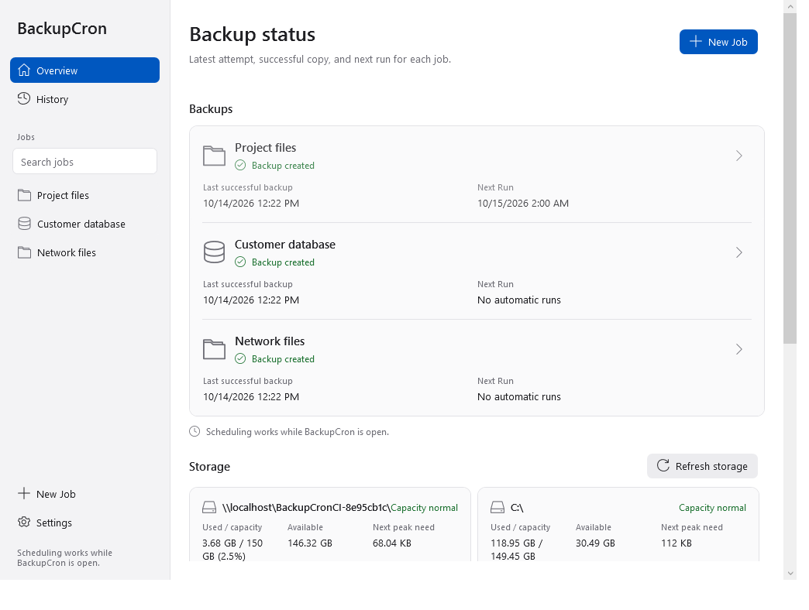
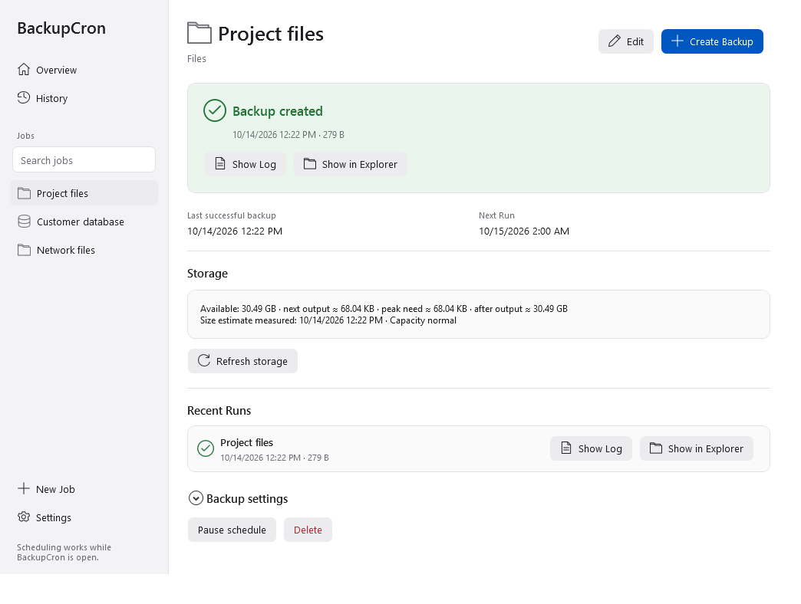
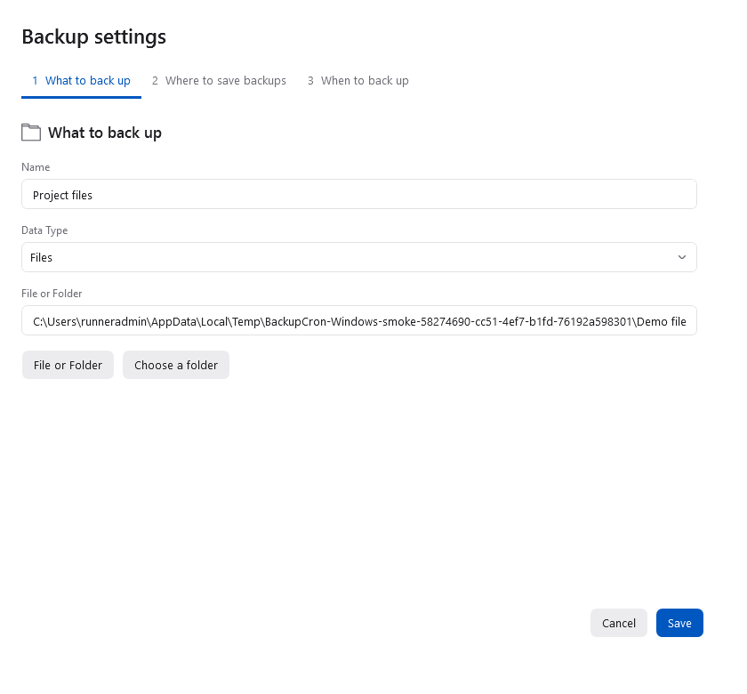
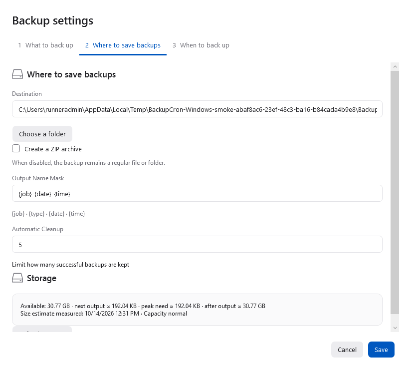
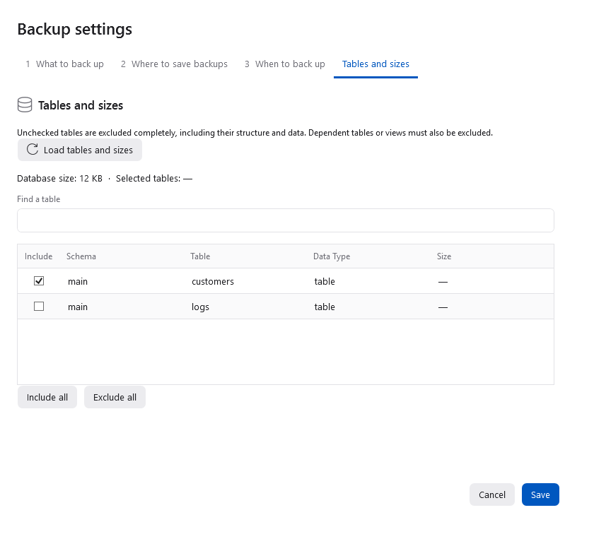

# BackupCron for Windows

A free, open-source Windows application for scheduled backups of files,
folders, projects and databases. No purchases, subscriptions or job limits.

## Download

[Download the Windows installer](https://github.com/backupcron/backupcron-windows/releases/download/v1.2.0/BackupCron-1.2.0-win-x64-setup.exe)

Windows 10 version 2004 or later, or Windows 11; 64-bit Intel/AMD.
The installer includes the .NET runtime and installs for the current user
without administrator privileges. The installer is currently unsigned by a
publisher certificate. Verify its SHA-256 against the release page.

## Interface

The layout follows the macOS application: a light sidebar, blue primary actions,
readable backup status rows and a dedicated page for each job. Windows window
controls, file pickers, keyboard navigation and high-contrast colors remain native.



| Job details | Backup editor |
| --- | --- |
|  |  |
|  |  |

Screenshots are rendered from the installed Windows application with isolated
example files and a SQLite database.

## Features

- macOS-style sidebar, backup status overview, job pages, editors, history and settings.
- Individual files, folders and projects: ordinary copies or ZIP archives.
- Project exclusions, including an explicit switch for Git metadata.
- SQLite consistent snapshots, including committed WAL data.
- PostgreSQL and MySQL dumps with their native command-line clients.
- Direct, Docker and SSH database connections and connection checks.
- Table sizes, search, numeric size sorting and complete table exclusions.
- Dependency checks for foreign keys, views, triggers and PostgreSQL partitions.
- Machine and destination storage overview: used/capacity, available space and fill percentage.
- Next-backup output, peak working space and projected free space after the output.
- Configurable low-space warnings in GB and percent, including account quotas on network shares.
- Backups targeting the same volume run one at a time and recheck space before writing.
- Manual, interval, hourly, daily and weekly schedules.
- Output templates: `{job}`, `{type}`, `{date}` and `{time}`.
- Retention of the last N successful outputs of the same job and destination.
- Progress, live logs, history, cancellation and verified output publication.
- Passwords encrypted with Windows DPAPI for the current user.
- Launch at login, notification-area operation, notifications and optional sounds.
- Ten interface languages, selected automatically or in settings.

Scheduling works while BackupCron is running. Closing its window keeps it in
the notification area; use the tray menu to quit. Autostart is optional.

SQLite support is included. Direct PostgreSQL/MySQL backups require their
clients; select `pg_dump.exe` or `mysqldump.exe` if automatic discovery fails.
Docker connections require Docker. SSH requires OpenSSH, a configured key and
a trusted host key; database credentials come from `.pgpass` or `.my.cnf` on
the remote server. BackupCron does not bypass SSH host verification.

Windows may require Developer Mode or suitable privileges to recreate symbolic
links in ordinary folder copies. ZIP entries retain links without following
them; use an extraction tool that understands symbolic-link entries.

## Storage monitoring

The overview checks local fixed disks, source and destination volumes, the app data
volume and temporary-file volume every minute, on restore and after a backup.
Use **Refresh storage** for an immediate check. Select a job or open its destination
tab for its next-output size, peak working-space estimate and projected remaining space.
Capacity reflects the Windows account quota where applicable. Disconnected or
unreadable locations show **Unavailable**, with the last successful check in the row tooltip.

Storage warnings are enabled by default, independently of backup-result notifications.
The defaults are **20 GB or 10% free**; configure either threshold in Settings (0
turns that threshold off). Stable warnings are not repeated every minute; an
escalation or a new warning after recovery produces a new notification. Windows
notification settings can still suppress notification-area balloons.

Estimates do not assume ZIP compression savings. File estimates refresh at most
every five minutes; the actual backup measures again before writing. Database
estimates use the last table inspection or backup and show their measurement time;
load tables to refresh them. Unknown estimates remain unknown. SQL dump estimates
are approximate, since database disk size is not its exported SQL size.

Temporary backup data is written inside the destination volume. Old successful
copies are pruned only after the new copy is verified and published; their
possible deletion is not credited in the preflight budget. Backups on a known
shared volume run sequentially. Different NAS shares may not expose that they
use the same physical disk. Other programs can consume space after a check.

## Build and verify

Install the .NET 10 SDK. On Windows, install Inno Setup 6 to build the installer.

```powershell
dotnet build BackupCron.Windows.slnx -c Release
dotnet run --project tests/BackupCron.Tests -c Release
./scripts/build-windows.ps1
```

The installer is written to `artifacts/`. GitHub Actions also verifies a real
installation, starts the installed app with isolated fixtures, checks DPAPI
and file/SQLite/SMB backups, native capacity queries and an upgrade from 1.1, exercises navigation and editing, renders the actual WPF windows, and tests uninstallation.
An additional job restores actual PostgreSQL and MySQL dumps into disposable
databases. Release publication requires both jobs to pass.

The core scenarios can also run on macOS/Linux; the WPF interface runs on Windows.
See [feature parity](docs/feature-parity.md) for the behavior shared with macOS.

## Contributing and support

Bug reports should include the Windows version, backup type, connection mode,
reproduction steps and redacted logs. Do not upload credentials or private data.
Stars, useful issues and pull requests are welcome.

The macOS application is maintained in [backupcron/backupcron](https://github.com/backupcron/backupcron).

## License

MIT. See [LICENSE](LICENSE). The Windows implementation ports behavior from the
MIT-licensed macOS BackupCron and reuses its ten localization dictionaries.
